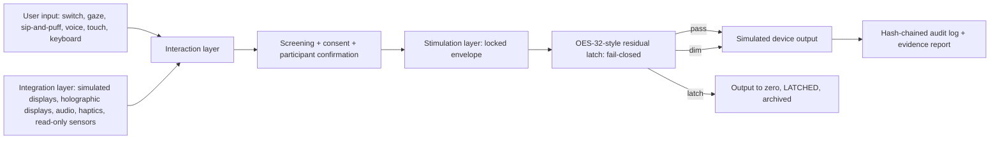

# Spark IIS API — Specification v2 (draft)

**Status: UNRUN.** This document describes a design. Anything not already listed in the
[README](README.md) endpoint table is not implemented. All numbers are tagged SYNTHETIC, REPORTED, TARGET or UNRUN.

> **Boundary statement**
> This software is not a medical device. It does not diagnose, treat, cure or prevent any condition.
> No therapeutic, neurological, "coherence", HBOT-synergy or quantum effect is claimed or established.

## 1. Purpose and architecture

One safe, accessible layer between people and simulated devices, in three layers. Every stimulation request passes
the safety envelope and the residual latch.



- **Integration** registers simulated devices with capability descriptors and calibrations. Sensors are read-only.
- **Interaction** maps every input method to the same small set of intents.
- **Stimulation** is the only layer that computes output, and only inside locked limits.
- **Residual latch** compares telemetry with a reference; past threshold it stops output and stays stopped until an
  operator clears it (archived).

## 2. Integration endpoints (implemented, `/v1`)

| Method | Path | Purpose |
|---|---|---|
| GET/POST | `/v1/devices` | Register/list simulated devices (`"simulated": true` required) |
| POST | `/v1/devices/{id}/calibrations` | Calibration record; a device without usable calibration stays disabled |
| POST | `/v1/sessions/{sid}/telemetry` | Read-only 32-value sensor frames into the latch |
| WS | `/v1/sessions/{sid}/stream` | Heartbeat / stop in, snapshot and events out |

## 3. Interaction (implemented)

- `POST /v1/participants` (pseudonymous), `PUT .../preferences`, `POST .../screenings`, `POST .../consents`,
  `DELETE .../consents/{cid}` (withdrawal stops sessions and deletes raw telemetry).
- `POST /v1/sessions/{sid}/interactions` with intents `stop`, `dim`, `comfort_rating`, `acknowledge`.
- `POST /v1/sessions/{sid}:stop` is **always 200**, idempotent, from any input and any state, with no confirmation.
- `:start` requires a confirmation from one of the participant's own input methods.
- A comfort rating ≤ 2 of 5 (TARGET) stops output.

## 4. Stimulation control (implemented)

- `POST /v1/protocols/{id}:validate` (dry run, every violation), `POST /v1/protocols` (stored only if valid).
- `POST /v1/sessions`, `:arm` (→ ARMED or REFUSED), `:start`, `:stop`, `:clear-latch`; `GET /v1/sessions/{sid}`.
- Locked limits (not configurable): no luminance/red flicker above **3 Hz** (TARGET, WCAG 2.3.1) and in v0.1 **no
  flicker at all**, only static output and fades with ramps ≥ 1 s (TARGET); saturated red ≥ 0.8 (TARGET) refused;
  flashing field > 25% (TARGET) refused; audio ≤ 70 dB(A) (TARGET) with ≥ 5 s fades (TARGET); haptic continuous
  ≤ 60 s (TARGET); session ≤ 20 min (TARGET) then 10 min break (TARGET); heartbeat gap > 500 ms (TARGET) stops.
- **7–8 Hz** is a research TARGET only; requests at that rate are refused (`PHOTOSENSITIVITY_FLASH_RATE`).
  Any change needs a separate research mode with ethics-board approval (UNRUN, not planned for v0.1).
- **HBOT is out of scope.** IDs such as `hbot`, `hyperbaric`, `oxygen`, `chamber` are refused (`MEDICAL_DEVICE`).
- Sensors can only dim or stop; nothing raises intensity or rate.

## 5. Data models and example payloads

Full SYNTHETIC examples live in [`examples/demo/`](examples/demo/). Illustrative shapes:

Interaction (implemented):
```json
{"input": "switch", "intent": "stop"}
```

Start confirmation (implemented):
```json
{"confirmation": {"input": "switch", "intent": "start"}}
```

Telemetry frame (implemented; values SYNTHETIC):
```json
{"sid": "s-…", "t_ms": 5000, "channel": "sensor-1", "x": [0.0, "… 32 finite numbers …"], "tag": "SYNTHETIC"}
```

Refusal (implemented, RFC 9457 problem+json, abridged):
```json
{"code": "SAFETY_ENVELOPE", "rule": "PHOTOSENSITIVITY_FLASH_RATE",
 "violations": ["PHOTOSENSITIVITY_FLASH_RATE", "RED_SATURATION", "FIELD_SIZE", "FADE_ONLY"]}
```

Latch (implemented; see `examples/demo/session-latched-evidence.json`): `S = 0.80 ≥ τ 0.50` (SYNTHETIC) →
`LATCHED`, reason `residual_latch`, cleared only via `:clear-latch` by an operator.

## 6. Fit with Spark AI NLP concepts

- **OES-32 residual contract:** reused as the latch. `R = max|x − x_ref|`;
  `S = 0.45·Peak + 0.35·RMS + 0.20·MeanAbs`; `S ≥ 0.50` (TARGET) latches, `0.35 ≤ S < 0.50` (TARGET) halves output.
  NaN/inf, wrong length, replay, stale reference or a sensor silent > 1000 ms (TARGET) latch. It is a stop bit only,
  not a measure of wellbeing, coherence or brain state.
- **Holographic displays** are display devices; "holographic error correction" is a design metaphor, not a physical
  claim.
- **Claim filter:** `claims` empty by default; therapeutic/neuro/coherence/HBOT/quantum claims refused
  (`CLAIM_FORBIDDEN`).
- **Archivist:** every session produces a hash-chained audit log, provenance manifest and evidence report.

## 7. Standards to build on (UNRUN integrations)

- [Lab Streaming Layer](https://labstreaminglayer.org/) for stream synchronisation.
- [BrainFlow](https://brainflow.org/) for device-neutral biosignal reading (read-only).
- [OpenXR](https://www.khronos.org/openxr/) for XR/holographic displays; Unity acts as an API client, no direct
  device access.
- [WCAG 2.2](https://www.w3.org/TR/WCAG22/) 2.3.1 Three Flashes or Below Threshold.
- IEC 62304 and ISO 14971, only if work ever moves beyond a non-medical research prototype.

## 8. Principles

- Consent can be withdrawn at any time, and that stops everything.
- The participant's own input methods come first; stop never needs fine motor control.
- Nothing runs on a person before ethics-board approval.
- The API never claims to treat, heal or regenerate.

## Differences from current implementation

The v2 concept message used illustrative names that differ from the v0.1 code. The code is authoritative:

| Concept (v2 draft) | Implemented (v0.1) |
|---|---|
| `POST /devices`, unprefixed paths | `/v1/...` prefix throughout |
| `GET /devices/{id}/status` | Not implemented; device health is via session state and heartbeat |
| `GET /sensors/{id}/stream` | Telemetry is pushed: `POST /v1/sessions/{sid}/telemetry`; WS stream is per session |
| `POST /models` (AI model registration) | Not implemented (UNRUN) |
| `POST /sessions` with profile + consent | Separate participant, preferences, screening, consent resources |
| `POST /intents` with `select`, `next`, `back`, `pause`, `stop` | `POST /v1/sessions/{sid}/interactions` with `stop`, `dim`, `comfort_rating`, `acknowledge` |
| BCI-like confidence score + second-input confirmation | Not implemented; no BCI input method exists (UNRUN) |
| `POST /stimulation/plans`, `/{plan}/start\|stop\|telemetry` | Protocols (`/v1/protocols`) + session verbs `:arm`, `:start`, `:stop` |
| Flicker allowed ≤ 3 Hz (e.g. 2.0 Hz example) | All flicker refused in v0.1 (`FADE_ONLY`); 3 Hz is the outer cap |
| Latch threshold 0.20 in example | τ = 0.50, dim at 0.35 (TARGET) |
| "Human ack" latch reset | Operator `:clear-latch` (archived); `operator_id` declared, not authenticated |
| Coherence metrics in telemetry | Not implemented; telemetry is raw 32-value frames scored only for the latch |
